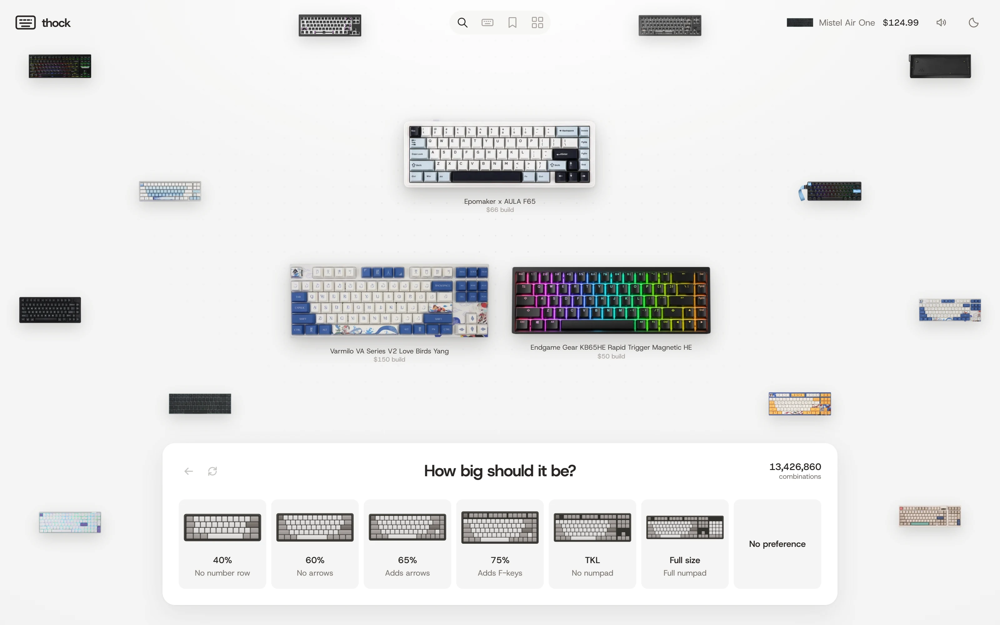
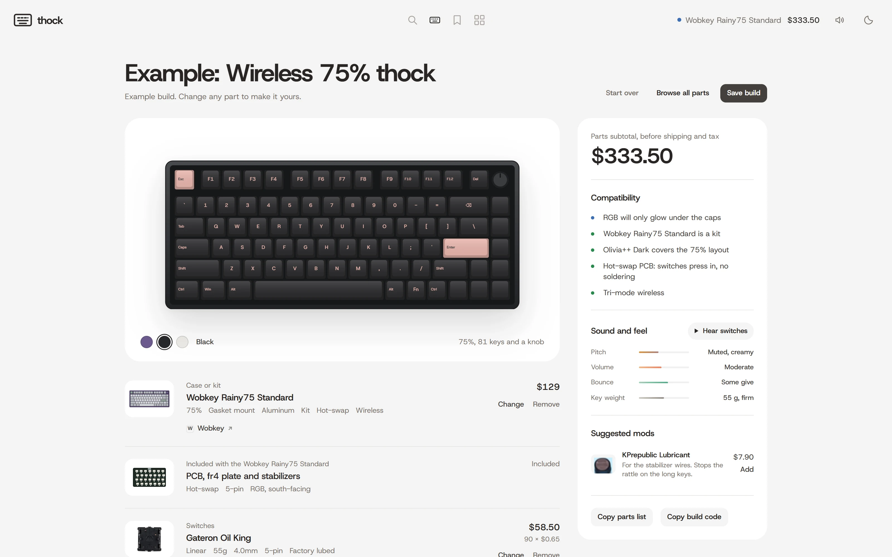
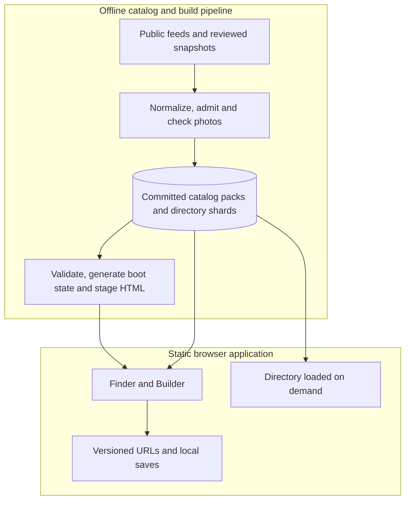

# Thock

**Find compatible mechanical keyboard parts across stores, then build, tune and share your board.**

[Try Thock](https://thock.cc) · [Quick start](#quick-start) · [Architecture](#architecture) · [Engineering notes](docs/architecture.md)



Custom keyboards spread cases, PCBs, plates, switches and keycaps across different retailers. Thock turns preferences into ranked builds and lets you change individual parts while checking compatibility. The app runs entirely in the browser; its catalog is assembled ahead of time from public store feeds and reviewed supplemental listings.

## Explore a build

| Find your starting point | Make it yours |
| --- | --- |
| **Finder:** answer questions about layout, feel, sound, appearance, use, connectivity, soldering and budget. Recommendations change with your answers. | **Builder:** pick parts directly, inspect compatibility warnings, change colors and preview the assembled layout. |
| **Swap and tune:** try replacement parts, undo a swap and review suggested mods within the remaining budget. | **Save and share:** keep builds in browser storage or send a versioned URL that encodes the selected parts and Finder answers. |
| **Directory:** search and filter listings, including sold-out products, with links to their source stores. | **Sound references:** listen to quiz examples and open creator sound-test videos or searches for switches. |

1. Open the Finder and choose a size, feel and sound. Some layout choices reveal additional questions.
2. Finish the quiz and open the matches. Inspect the parts and prices, then try a swap.
3. Open Builder to edit a board directly. Save it locally or copy a share link.



Screenshots show the committed catalog at capture time, not guaranteed current stock. [Reproduce the captures](docs/media/README.md).

## Architecture



1. [sync-catalog.mjs](scripts/sync-catalog.mjs) ingests retailer feeds; [catalog-lib.mjs](scripts/catalog-lib.mjs) normalizes variants, pack sizes and builder admission.
2. [catalog-pack.mjs](scripts/catalog-pack.mjs) writes builder packs; the directory gets a separate index and product-detail shards.
3. [boot-data.mjs](scripts/boot-data.mjs) runs the page's recommendation code to prepare the initial board field; [stage-site.mjs](scripts/stage-site.mjs) produces static view entry points and content-hashed asset references.
4. [index.html](index.html) paints the initial Finder, then loads the complete catalog for ranking and editing. [directory.js](assets/directory.js) loads its index when opened.
5. [share-code.js](assets/share-code.js) encodes builds into URLs. Saved builds stay in browser storage; there is no account backend.

## Engineering worth inspecting

| Problem | Approach and rationale | Tradeoff |
| --- | --- | --- |
| A large parts catalog can delay the first useful screen | Generate and verify a small boot snapshot using the **same ranking code** as the browser. Full catalog loading follows first paint. | Build extraction depends on source markers; later interactions still need the complete catalog. |
| An incomplete crawl can silently remove usable parts | Reject required-source failures, incomplete pagination, empty feeds and catalog shrink greater than 20%. Validate and test before committing refreshed data. | Legitimate large catalog changes need review; optional sources and reviewed snapshots can be stale. |
| Share builds on static hosting without server storage | Encode stable part IDs and versioned quiz answers directly into the URL. | Store-code order and question versions become compatibility contracts; removed parts remain unavailable. |

[Read the module-level walkthrough, constraints and test evidence](docs/architecture.md).

## Stack and data

| Responsibility | Implementation |
| --- | --- |
| Browser UI and state | HTML, CSS and plain JavaScript; SVG board illustrations; browser storage |
| Catalog ingestion and staging | Node.js 22+, public Shopify feeds, reviewed supplemental snapshots, JSON packs and shards |
| Product-image checks | sharp, checked crops and illustration fallbacks |
| Verification | Node built-in test runner and Playwright Chromium |
| Hosting and automation | GitHub Pages and GitHub Actions |

The [catalog manifest](data/catalog-manifest.json) records generation time, source status, listing counts, sold-out builder parts and admission exclusions. Those values change with refreshes; a listing count is not a count of in-stock compatible builds. The refresh workflow is scheduled for **09:17 UTC daily**, subject to source availability and validation gates.

## Quick start

Requires **Node.js 22 or newer** and npm. No API keys, database or catalog recrawl are needed to try the checked-in snapshot.

```sh
git clone https://github.com/gothicscientist/thock.git
cd thock
npm ci
npm run site:stage
npm run preview
```

Open [http://127.0.0.1:4173](http://127.0.0.1:4173). The preview serves `dist/`, including `/build`, `/directory`, `/saved` and `/about`. Serve over HTTP: opening HTML directly from disk does not support catalog fetching. Stop with Ctrl+C. Re-run staging after source changes.

## Verification and maintenance

```sh
npm test
npm run catalog:check
npm run docs:check
npx playwright install chromium
npm run test:ui
npm run test:boot
```

Unit tests cover admission, recommendations, combinations, swaps, share-code round trips, links, images and search metadata. Browser checks exercise keyboard controls, focus, navigation, responsive layouts, image failures and views opened before catalog loading finishes. External images in behavioral tests use fixtures; these tests do not verify live retailer availability.

To refresh retailer data explicitly:

```sh
npm run catalog:sync
```

This contacts stores and rewrites generated catalog files. Offline refresh (`npm run catalog:sync -- --offline`) requires `.cache/` feed snapshots from a previous crawl; those snapshots are not included in a fresh clone. Normal local development uses the committed data.

### Configuration

[.env.example](.env.example) documents optional process variables for YouTube discovery, an existing Chromium binary and a custom staging directory. Scripts do **not** automatically load `.env` files. Default staging rebuilds `dist/`; a custom output directory is deleted before staging, so it must be disposable. See the [catalog workflow](.github/workflows/catalog.yml) for optional API-secret wiring.

## Repository map

| Path | Start here for |
| --- | --- |
| [index.html](index.html) | Quiz, ranking engine, compatibility, swaps and builder UI |
| [assets/](assets/) | Directory, sharing, names, themes, sounds and browser helpers |
| [scripts/](scripts/) | Ingestion, normalization, image checks, staging and preview |
| [data/](data/) | Committed catalog, manifest, product links and directory shards |
| [tests/](tests/) | Unit and browser verification |
| [.github/workflows/](.github/workflows/) | Refresh, sound generation and Pages deployment gates |
| [DESIGN.md](DESIGN.md) | Visual rules and interaction decisions |
| [docs/](docs/) | Architecture, product-link and sound-source documentation |

## Status and limits

Thock is a static application with automated refresh and deployment workflows. Compatibility checks depend on retailer metadata and inferred specifications; confirm exact PCB, plate, layout and kit contents before buying. Prices exclude shipping and taxes and can change after capture. Sound examples are references, not predictions of an assembled board.

Local saves belong to one browser and do not sync across devices. There is no checkout or stock reservation. Optional sources and manually reviewed 40% listings have different freshness guarantees from required feed sources.

Useful next work: broaden explicit fit metadata, make source freshness easier to inspect, and add reproducible end-to-end demo recordings. These are proposed improvements, not shipped capabilities.

## Credits and usage rights

Product names, photos and prices belong to their retailers. Quiz and interface audio credits are in [assets/sounds/CREDITS.md](assets/sounds/CREDITS.md); quiz-image credits are in [assets/quiz/CREDITS.md](assets/quiz/CREDITS.md). [Sound-test sources](docs/sound-sources.md) link to creators rather than redistributing their videos. [Affiliate configuration](assets/affiliates.js) supports optional codes and an on-site disclosure when enabled.

**No project-wide software license is currently included.** Public source availability does not grant a general reuse license. Third-party asset terms remain separate; the owner must choose software licensing terms before this is described as open source.
